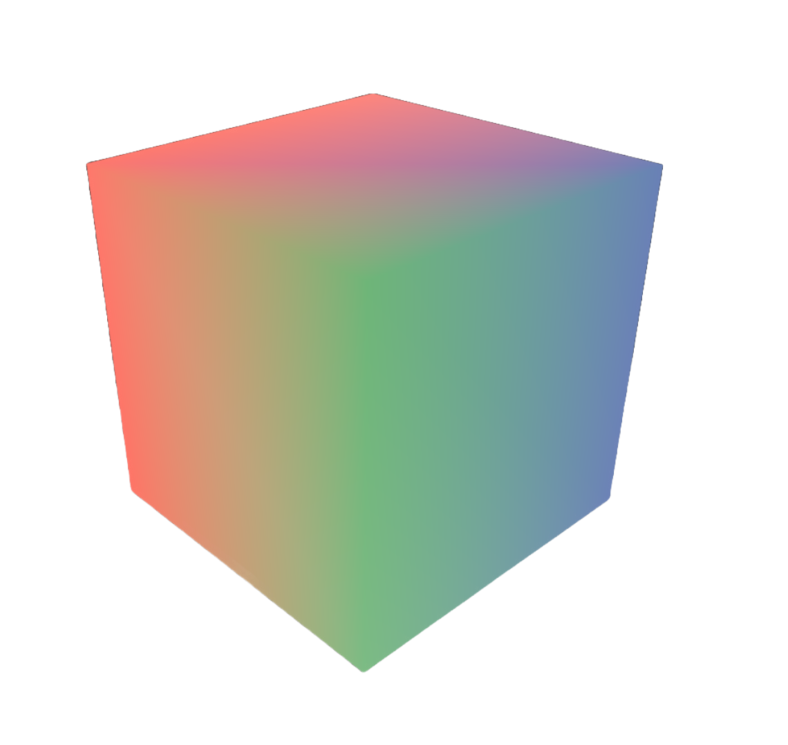

# 👁️ Vertex Paint

Vertex Paint is a **VIBE CODED** Blockbench Plugin that finally delivers the missing feature of, well, Vertex Painting. It features everything from brush sizes, opacity, and multi-vertex coloring!

# REMEMBER - THIS IS VIBE CODED
Don't use this on projects you really care about. (I will though lol)

# Tools
Vertex Paint comes with two tools that should be able to handle any project you throw at them.

1. Vertex Paint Tool: This allows you to color particular vertices depending on your brush size. The Softness of your brush acts as a falloff, and Opacity controls the Alpha of that vertex.

2. Vertex Paint Bucket: Like you'd expect, this tool will color all selected verticies according to your selected Color & Opacity settings in one click.

3. Vertex Toggle: This allows you to toggle visibility for Vertex Colors as a whole.

4. Vertex Eraser: Removes a Vertex's color data (Erasing it)

5. Disable Depth: Allows you to paint verticies THROUGH the model rather than just on the side your camera faces.

## 🖥️🌐 Install
Installation is the same as every other Blockbench Plugin. Simply grab it from the Plugin Store, or Load the Plugin from the Javascript (`vertex_paint`) file.

## Acceditation
Thanks SO much to DataGuySM64's BBColor Plugin Attempt. You can find it here - https://github.com/DatguySM64/bbcolor

Without his work, it would've been basically impossible for me to sanity check any of the export code I vibed out for this plugin.

Although it's too advanced for my usecase I highly encourage you to check it out. It offers finer control and more detailed tooling, including masks.