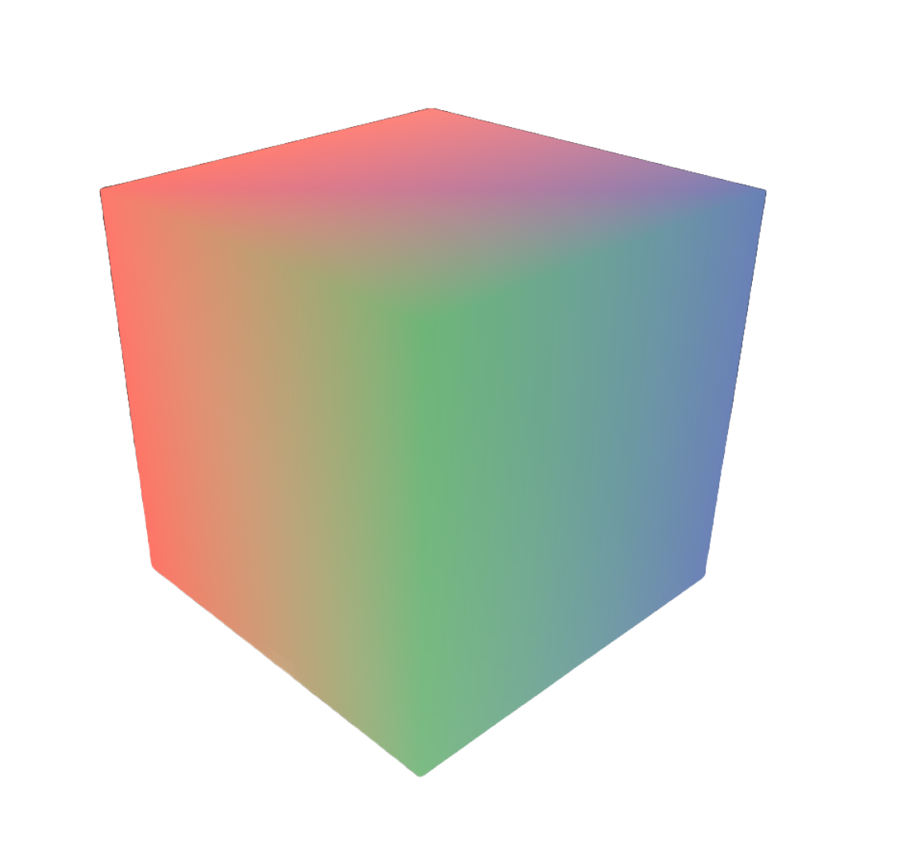

# 👁️ Vertex Paint

Vertex Paint is a **VIBE CODED** Blockbench Plugin that finally delivers the missing feature of, well, Vertex Painting. It features everything from brush sizes, opacity, and multi-vertex coloring!

# REMEMBER - THIS IS VIBE CODED
Don't use this on projects you really care about. (I will though lol)

# Tools
Vertex Paint comes with three dedicated tools and viewport controls:

1. **Vertex Paint Tool**: Paint mesh vertices using native brush size, softness falloff, and opacity controls. (Holding **Ctrl** also acts as a quick erase shortcut).
2. **Vertex Paint Bucket**: Color selected vertices, faces, or entire mesh elements in one click using your active palette color and opacity.
3. **Vertex Paint Eraser**: Dedicated eraser tool that cleanly erases mesh vertex colors back to neutral white (`#ffffff`) using brush size, falloff, and opacity controls. The brush cursor renders rose-red for visual clarity.

### View & Tool Options
- **Toggle Vertex Colors (Eye Icon)**: Toggle vertex color visibility on or off in the 3D viewport at any time (under View menu).
- **Ignore Depth Toggle**: Paint through occluded vertices ignoring surfaces in front (under Tools menu).
- **Buildup / Airbrush Toggle**: When enabled, repeated brush movements over vertices within a single stroke continuously accumulate color (spaced to eliminate jitter doubling). When disabled (default), stroke strength is cleanly capped at the brush opacity regardless of how many times you scrub over a vertex.

## ⚠️ Known Limits
- **Multiply-based Tinting**: In Blockbench's textured shader and standard glTF engines (e.g. Godot with `Use As Albedo`), vertex colors multiply into the texture albedo (`albedo = texture * vertex_color`). White (`#ffffff`) is neutral (unpainted), and colors darken/tint the underlying texture.
- **Topology Changes**: Newly created faces from modeling operations (such as extrude, loop cut, or subdivide) initialize with default neutral white vertex colors until painted.

## 🖥️🌐 Install
Installation is the same as every other Blockbench Plugin. Simply grab it from the Plugin Store, or Load the Plugin from the Javascript (`vertex_paint`) file.

## Accreditation
Thanks SO much to DataGuySM64's BBColor Plugin Attempt. You can find it here - https://github.com/DatguySM64/bbcolor

Without his work, it would've been basically impossible for me to sanity check any of the export code I vibed out for this plugin.

Although it's too advanced for my usecase I highly encourage you to check it out. It offers finer control and more detailed tooling, including masks.